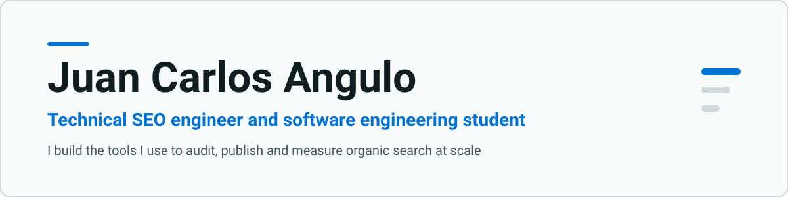

<h1 align="center">
  <picture>
    <source media="(prefers-color-scheme: dark)" srcset="assets/banner-dark.svg">
    
  </picture>
</h1>

Technical SEO engineer and software engineering student. I build the tools I use to audit, publish and measure organic search at scale.

Lima, Peru · UPC Software Engineering (graduating December 2027) · English C1 · [juan-tech.com](https://juan-tech.com)

## What I do

- **Technical SEO.** Five years running organic growth for 18+ international clients: crawl and indexation, site migrations, structured data, international SEO.
- **Software that automates that work.** Crawlers, audit engines, reporting bots and content pipelines in TypeScript, Python and Node.
- **Websites with SEO built in.** Next.js, Astro, Payload CMS and WordPress, with Core Web Vitals and schema handled from the first commit.

## Selected work

| Project | What it does | Stack |
|---|---|---|
| [Audits-JuanTech](https://github.com/Sve-nnN/Audits-JuanTech) | Audit platform. Crawls up to 500 URLs, runs over 30 checks across technical SEO, on-page, structured data and AI search visibility, adds Core Web Vitals through PageSpeed Insights and diffs every run against the previous one. | Next.js, Node, BullMQ, Prisma, PostgreSQL |
| [SEO-Skills](https://github.com/Arianna-Lupi/SEO-Skills) | 20 skills and 3 agents that automate SEO workflows inside Claude Code, installable with one command. Also works with Cursor, Codex and Copilot. | Markdown skills, Python, shell |
| [TaskAutomation](https://github.com/Arianna-Lupi/TaskAutomation) | Turns a free-form Slack message into a complete ClickUp task. Verifies Slack signatures, deduplicates retries and runs on serverless. | TypeScript, Slack Bolt, Upstash, Vitest |
| [Client-Rank-Reporting](https://github.com/Arianna-Lupi/Client-Rank-Reporting) | Slack bot that reports Search Console metrics per client, with day over day change. | TypeScript, Vercel, Upstash |
| [opportunities](https://github.com/Sve-nnN/opportunities) | Personal dashboard that syncs internship and program listings from public GitHub sources and tracks my applications. | Next.js, Drizzle, PostgreSQL |
| [loopsgrowth-landing](https://github.com/Arianna-Lupi/loopsgrowth-landing) | Static acquisition site for an SEO and GEO agency. | Astro, Tailwind |

Client tooling such as the content engine, technical audit automation and market audit scripts lives in private repositories. I am happy to walk through any of it.

## Stack

  
  
  
  
  
  
  
  
  
  
  
  

- **Languages:** TypeScript, JavaScript, Python, SQL, Java, C++
- **Web:** Next.js, React, Astro, Payload CMS, WordPress, Webflow
- **Data and infra:** PostgreSQL, Drizzle, Prisma, BullMQ, Redis, Docker, Dokploy
- **SEO:** Search Console, GA4, Screaming Frog, Ahrefs, PageSpeed Insights, Schema.org

## How I work

- I build the tools I use to audit, publish and measure organic search, and I automate whatever I catch myself repeating.
- Audits-JuanTech has 33 check ids and 438 tests, so I trust what it reports.
- Core Web Vitals and schema go in from the first commit, not in a cleanup pass.
- Client work stays private, and I'll walk anyone through it.

## Activity

Both images below are generated daily by GitHub Actions from public data.

<picture>
  <source media="(prefers-color-scheme: dark)" srcset="assets/snake-dark.svg">
  
</picture>

## Contact

[LinkedIn](https://www.linkedin.com/in/juancangulo/) · [Email](mailto:juancarlosanguloabud@gmail.com) · [juan-tech.com](https://juan-tech.com)
